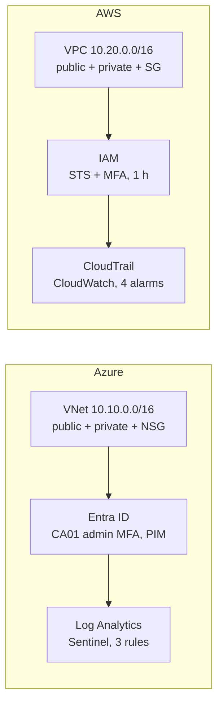

# cloud-security-mirror

One secure architecture, deployed side by side on **Azure** and **AWS**, on a **€0 budget**.
The project covers network segmentation, least-privilege identity, logging and detection, all reproducible as code (Terraform).

> The detailed write-ups in `docs/` are written in French.

## What this project demonstrates

| Skill | Azure | AWS |
|---|---|---|
| Network segmentation (public / private) | VNet, subnets, NSG | VPC, subnets, route tables, security groups |
| Least-privilege identity | Entra ID, group-based RBAC, PIM, Conditional Access | IAM, roles, STS with MFA |
| Logging and detection | Log Analytics, Microsoft Sentinel, 3 detection rules | CloudTrail, CloudWatch, SNS, 4 alarms |
| Cost control | Budget, Azure for Students, planned cleanup | AWS Budgets, Free Plan, no NAT Gateway |
| Infrastructure as Code | Terraform (network, RBAC, Sentinel rules) | Terraform (network, detection) |
| Investigation and hunting | Incident report, documented KQL hunting queries | Alarms tested, logs analysed |

## Architecture



Shared design principle: a single allowed flow from the public subnet to the private subnet (PostgreSQL, port 5432), no unnecessary public addresses, and administrative rights that are temporary and logged.

## Azure vs AWS comparison

| Topic | Azure | AWS |
|---|---|---|
| Default internal traffic | Allowed inside the VNet (`AllowVnetInBound`), must be blocked explicitly | Denied inbound by default (security group) |
| What makes a subnet "public" | Public IP + filtering rules | A `0.0.0.0/0` route to an internet gateway |
| Temporary admin rights | PIM (requires an Entra ID P2 licence) | Role assumed via STS with MFA (no extra licence) |
| Audit log | Activity log + Entra logs | CloudTrail |
| Detection | Sentinel KQL rules, incidents | Metric filters + alarms + SNS |
| Spending cap | Student subscription disabled when credit runs out | Free Plan: account closed when credits run out |
| Advanced detection services | Defender for Cloud (free tier used) | GuardDuty and Security Hub unavailable on the Free Plan: code written, not deployed |

## Repository structure

```text
.
├── README.md
├── .github/workflows/terraform-checks.yml   # automated validation of the code
├── docs/                                    # write-up for each phase (French)
│   ├── 00-scope.md
│   ├── 01-azure-networks-identity.md
│   ├── 02-azure-identity-detection.md
│   ├── 03-aws-network-identity.md
│   ├── 04-aws-detection.md
│   ├── hunting/hunting-queries.md           # threat hunting (KQL)
│   ├── investigations/incident-04.md        # incident investigation report
│   └── img/                                 # screenshots (identifiers redacted)
├── azure/
│   ├── terraform/                           # network, RBAC, Sentinel rules
│   ├── ca-not-applied/                      # Conditional Access: validated, not applied
│   └── detections/                          # exported detection rules
├── aws/
│   ├── terraform/                           # VPC, subnets, security groups
│   ├── terraform-detection/                 # CloudTrail, alarms, SNS
│   └── guardduty-not-applied/               # GuardDuty / Security Hub: validated, not applied
└── scripts/aws-login.ps1                    # temporary AWS session with MFA
```

## Suggested reading order

1. `docs/00-scope.md`: the threat model that drives every design choice.
2. The phase write-ups in `docs/`, in order (controls, evidence, problems encountered).
3. `docs/investigations/incident-04.md`: how I analyse an incident.
4. `docs/hunting/hunting-queries.md`: how I hunt for anomalies.
5. The Terraform code, folder by folder.

## Reproducing the project

Requirements: Terraform 1.5 or later, Azure CLI, AWS CLI, an Azure subscription and an AWS account.

**Azure** (network and permissions):
```powershell
az login
$env:ARM_SUBSCRIPTION_ID = (az account show --query id -o tsv)
cd azure/terraform
terraform init
terraform plan -out=tfplan
terraform apply tfplan
terraform destroy      # removes everything Terraform created
```
The Sentinel rules in `azure/terraform` reference an existing Log Analytics workspace (see `sentinel.tf`). The Conditional Access policies (`azure/ca-not-applied`) are **intentionally not applied**: a mistake can lock you out of the directory.

**AWS** (session with MFA, no permanent admin key):
```powershell
. .\scripts\aws-login.ps1 -RoleArn "<ROLE_ARN>" -MfaSerial "<MFA_ARN>" -Code "<MFA_CODE>"
cd aws/terraform
terraform init
terraform plan -out=tfplan
terraform apply tfplan
terraform destroy
```

## Cost-control rules followed

- Budget and alerts **before** any resource.
- Cost of each resource checked before creation (official pricing pages when available; secondary sources flagged as such).
- No NAT Gateway, public IP address or virtual machine.
- Free trials contained: licence quantity limited, trial-end reminders, cleanup plan.
- Deliberate decision not to switch to the AWS Paid Plan for GuardDuty and Security Hub, to keep the Free Plan's automatic spending cap.

## Known limitations

- The Azure trials (Entra ID P2, Sentinel) are temporary: PIM and Sentinel disappear when they end, which is why the code is versioned.
- GuardDuty and Security Hub: code validated, not deployed.
- No real traffic test between subnets (no machine created, to avoid public IP and NAT costs): the evidence relies on configuration.
- KMS encryption of logs and data events are not enabled (cost): to be enabled in production.
- IAM user + role on AWS rather than IAM Identity Center, as a deliberate teaching choice.

## Project status

The Azure trials (Entra ID P2 and Sentinel) end on 14 and 15 November 2026. The manually built Log Analytics workspace is scheduled for deletion on 12 November 2026; the detection rules remain available as code in `azure/terraform/sentinel.tf` and `azure/detections/`.

## Repository security

No secret is published: Terraform state files, `.tfvars` files, plans and keys are excluded by `.gitignore`. Screenshots are redacted (account IDs, ARNs, domains, email addresses).