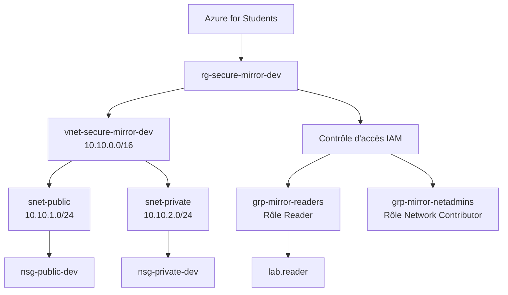

# Phase 1 - Azure : réseau segmenté et identité en moindre privilège

## Objectif
Construire un réseau Azure fonctionnel avec deux zones (publique et privée) et prouver deux choses : le trafic entre zones est restreint à ce qui est nécessaire, et les droits d'administration suivent le moindre privilège.

## Architecture

| Ressource | Rôle | Coût | Source |
|---|---|---|---|
| Groupe de ressources `rg-secure-mirror-dev` | Conteneur logique, suppression en un bloc | Gratuit | Connaissance générale d'Azure, non revérifié sur la page officielle |
| VNet `vnet-secure-mirror-dev` (10.10.0.0/16) | Réseau privé isolé | Gratuit | Page tarifaire Azure Virtual Network |
| `snet-public` (10.10.1.0/24) | Zone applicative | Gratuit | idem |
| `snet-private` (10.10.2.0/24) | Zone données | Gratuit | idem |
| `nsg-public-dev` / `nsg-private-dev` | Filtrage du trafic | Gratuit | Source secondaire (pas de frais directs pour le service) |
| Budget 15 $ + alertes | Détection de dépense anormale | Gratuit | Documentation Azure for Students / Cost Management |

Non créé volontairement : NAT Gateway (facturée dès la création, à l'heure et au Go traité, risque de vider le crédit si oubliée).

## Choix de sécurité justifiés
1. **Deux sous-réseaux séparés.** Limite le mouvement latéral : un composant compromis en zone publique ne voit pas toute l'infrastructure.
2. **Règle explicite `Deny-VNet-Inbound` (priorité 4000).** Par défaut, Azure autorise tout le trafic interne au VNet (`AllowVnetInBound`, 65000). Sans cette règle, la séparation visuelle des sous-réseaux ne protège rien.
3. **Un seul flux public vers privé autorisé** : TCP 5432 depuis 10.10.1.0/24 uniquement (exemple PostgreSQL). Tout le reste est refusé.
4. **Sous-réseaux privés sans accès sortant par défaut.** Une machine compromise ne peut pas contacter Internet sans autorisation explicite.
5. **RBAC par groupes, au niveau du groupe de ressources.** Reader pour la lecture, Network Contributor pour l'administration réseau. Droit minimal, périmètre minimal, facile à auditer et à retirer.
6. **Budget et alertes avant toute ressource.** Une dépense anormale est aussi un indicateur de compromission.

## Preuves
- Test de refus : un utilisateur Reader (`lab.reader`) ne peut pas créer de règle de sécurité (« Échec de la création de la règle de sécurité »).
- Règles par défaut et personnalisées des NSG visibles dans le portail.
- Captures associées : dossier `img/`, fichiers préfixés `01-`.

## Problèmes rencontrés
- **Région de déploiement.** Mes ressources ont été refusées dans la région prévue (France). Une stratégie Azure Policy de l'abonnement limite les régions autorisées ; je l'ai repéré en lisant les journaux d'activité, et j'ai déployé en Allemagne.
- **Règles NSG par défaut.** Je pensais d'abord qu'elles n'étaient que des autorisations. En réalité, il y a `AllowVnetInBound` (65000), `AllowAzureLoadBalancerInBound` (65001) puis `DenyAllInBound` (65500) : la règle qui autorise le trafic interne est atteinte avant le refus total, d'où la règle de refus explicite à 4000.

## Limites connues
- Le blocage SSH entre sous-réseaux n'est pas démontré par un test réel (aucune machine de test, pour éviter les coûts d'IP publique).
- La journalisation et la détection sont traitées en phase 2.

## Ce que je retiens
Cette première phase m'a permis de comprendre que la segmentation d'un réseau dépend autant des règles effectives que de la séparation des sous-réseaux. Les règles NSG par défaut peuvent autoriser des communications internes qu'il faut examiner avant de définir une politique de refus. J'ai également découvert que les stratégies Azure Policy de l'abonnement peuvent limiter les régions de déploiement, indépendamment de la configuration du réseau. Enfin, l'attribution des rôles Azure par groupes permet de séparer les permissions de lecture et d'administration réseau selon le principe du moindre privilège.