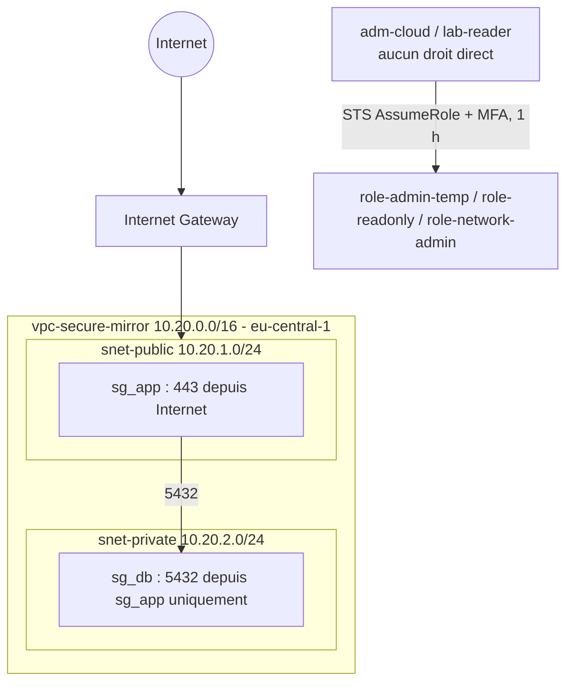

# Phase 3 - AWS : réseau segmenté et identité en moindre privilège

> Projet : architecture sécurisée déployée en miroir sur Azure puis AWS, à budget 0 €.
> Cette phase construit le socle AWS : compte, budget, identité temporaire (STS) et réseau (VPC).
> Statut : réalisée en octobre 2026.

## 1. Objectif

Reproduire sur AWS les principes posés sur Azure :
1. un réseau séparé en zone publique et zone privée, avec un seul flux autorisé entre les deux ;
2. aucune utilisation du compte root au quotidien ;
3. des droits d'administration temporaires, accordés avec MFA et tracés ;
4. des rôles de moindre privilège, avec preuve de refus ;
5. tout cela à 0 €.

## 2. Contraintes

| Contrainte | Détail |
|---|---|
| Budget | 0 € (plafond toléré : 5 €) |
| Offre AWS | Free Plan : 100 $ de crédits, 6 mois, compte fermé à l'expiration ou à l'épuisement des crédits (sources secondaires) |
| Région de travail | eu-central-1 (Francfort), miroir de la région Azure utilisée en Allemagne |
| Limite constatée | GuardDuty et Security Hub indisponibles en Free Plan (voir phase 4) |

## 3. Architecture

### Correspondance avec Azure

| Azure | AWS |
|---|---|
| VNet 10.10.0.0/16 | VPC 10.20.0.0/16 |
| Sous-réseau public/privé (filtrage NSG) | Sous-réseau public : route `0.0.0.0/0` vers l'IGW ; privé : aucune route Internet |
| NSG, `AllowVnetInBound` autorise le trafic interne par défaut | Security group : tout refusé en entrée par défaut |
| Règle `Deny-VNet-Inbound` ajoutée | Non nécessaire : le refus est le comportement par défaut |
| `adm.cloud` éligible via PIM | Utilisateur `adm-cloud` + rôle `role-admin-temp` (STS, MFA, 1 h) |
| `lab.reader` + rôle Reader | `lab-reader` + rôle `role-readonly` |
| Compte d'urgence | Compte root avec MFA, non utilisé au quotidien |
| Budget Azure + crédit étudiant (abonnement désactivé à l'épuisement) | AWS Budgets + crédits Free Plan (compte fermé à l'épuisement) |

### Ressources et coûts

| Ressource | Coût | Source |
|---|---|---|
| VPC, sous-réseaux, tables de routage, security groups, IGW | Gratuit | Sources secondaires |
| IAM, rôles, STS | Gratuit | Sources secondaires |
| AWS Budgets (alertes seules, sans actions ni rapports) | Gratuit | Page officielle AWS Budgets |
| NAT Gateway | **Non créée** : environ 0,045 $/heure + 0,045 $/Go | Source secondaire |
| Elastic IP / IPv4 publique | **Non créée** : 0,005 $/heure par adresse | Source secondaire |

## 4. Menaces, contrôles et preuves

| Menace | Contrôle | Preuve |
|---|---|---|
| Vol d'identifiants d'un administrateur | MFA sur root et utilisateurs, aucun droit direct, rôle temporaire avec MFA et session d'1 heure | `CreateVpc` refusé avant le changement de rôle, réussi après |
| Ressource privée exposée | Sous-réseau privé sans route vers l'IGW, security groups | Table `rt-private` : seule la route locale |
| Mouvement latéral | `sg_db` n'accepte que 5432 depuis `sg_app` | Règles entrantes de `sg_db` |
| Action privilégiée non détectée | Événements d'activation tracés dans CloudTrail | Événement `CreateVpc` signé `adm-cloud` ; détection ajoutée en phase 4 |
| Consommation abusive | Budget mensuel de 5 $ avec alertes (50 % et 80 % du coût réel, 100 % de la prévision), aucune ressource payante | Budget créé |

## 5. Choix de sécurité justifiés

1. **MFA root par application d'authentification.** AWS a mis fin à la MFA par SMS. Une seconde méthode est recommandée pour éviter d'être bloqué.
2. **Utilisateur du quotidien sans droit direct.** `adm-cloud` ne peut qu'endosser un rôle. En cas de vol de son mot de passe, l'attaquant a besoin de la MFA et obtient au mieux une session d'une heure tracée.
3. **MFA exigée dans la politique d'approbation du rôle** (`aws:MultiFactorAuthPresent`).
4. **MFA par application, pas par passkey seule, pour les identités qui utilisent STS** : AWS indique qu'on ne peut pas transmettre les informations d'une passkey aux opérations STS.
5. **Security group comme source d'une règle** : la règle suit l'appartenance au groupe et non une adresse IP. En contrepartie, celui qui peut attacher `sg_app` à une ressource obtient l'accès à la base : l'IAM protège donc aussi le réseau.
6. **Aucune NAT Gateway ni IP publique** : coûts évités, surface d'exposition réduite.
7. **Groupe `grp-netadmins` sans membre**, comme en Azure : le rôle existe, personne ne l'utilise tant qu'on n'en a pas besoin.

## 6. Preuves de moindre privilège

- `adm-cloud`, sans rôle : `ec2:CreateVpc` refusé (« no identity-based policy allows the action »).
- `adm-cloud`, après changement de rôle : `CreateVpc` réussi, événement visible dans CloudTrail avec le nom de la session. VPC de test supprimé.
- `lab-reader`, sans rôle : `iam:ListGroups` refusé.
- `lab-reader` avec `role-readonly` : lecture possible, `ec2:AuthorizeSecurityGroupEgress` refusé sur `sg_db`.
- Captures associées : dossier `img/`, fichiers préfixés `03-`.

## 7. Problèmes rencontrés

1. **Région par défaut incorrecte.** Mes premières ressources ont été créées dans la région Asie-Pacifique (ap-southeast-2) : repéré en lisant un message d'erreur. La région dépend du sélecteur de la console et non de l'adresse IP. J'ai supprimé et reconstruit dans eu-central-1, ce qui a coûté 10 à 15 minutes car tout était gratuit.
2. **Nom des groupes.** Le préfixe `sg-` est réservé aux identifiants AWS : j'ai utilisé des underscores (`sg_app`, `sg_db`).
3. **Bruit dans CloudTrail.** Les premiers événements affichés venaient d'un service interne (`resource-explorer-2`), pas de mes actions. Savoir écarter les événements de services est une compétence d'analyse.
4. **Test fait avec le mauvais compte.** Une première tentative de test a été faite avec l'utilisateur seul plutôt qu'avec le rôle : le refus prouvait quand même que l'utilisateur n'a aucun droit propre.

## 8. Limites connues

- Pas de test de trafic réel entre les groupes : aucune instance créée, pour éviter les coûts d'IP publique et de NAT. La preuve repose sur la configuration.
- `ReadOnlyAccess` est large (lecture de nombreux services). Une politique plus étroite serait préférable en production.
- `role-network-admin` est créé mais n'a pas été testé.
- Utilisation d'un utilisateur IAM + rôle ; AWS recommande IAM Identity Center pour l'accès des humains.
- Les règles de sortie des security groups n'ont pas été restreintes dans la construction manuelle (tout est autorisé par défaut).
- Le Free Plan se termine au bout de 6 mois : le projet est reproductible par le code (phase 5).

## 9. Ce que je retiens

Sur AWS, ce qui rend un sous-réseau public est sa table de routage (une route vers la passerelle Internet), pas son nom : c'est l'inverse de mon réflexe côté Azure, où le filtrage par NSG joue ce rôle. Le refus implicite m'a appris qu'une action est interdite tant qu'aucune politique ne l'autorise, et qu'un utilisateur sans droit propre qui endosse un rôle avec MFA donne le même effet que PIM, avec une trace dans CloudTrail. J'ai aussi compris que le security group comme source d'une règle est pratique mais déplace la protection vers l'IAM : celui qui peut attacher le groupe obtient l'accès. Enfin, une erreur de région par défaut m'a rappelé de vérifier le contexte avant chaque création.