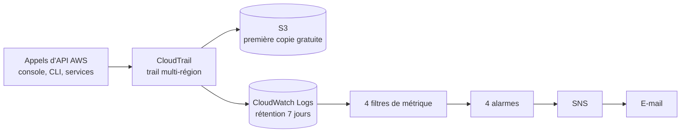

# Phase 4 - AWS : journalisation et détection

> Projet : architecture sécurisée déployée en miroir sur Azure puis AWS, à budget 0 €.
> Cette phase met en place la journalisation (CloudTrail), les alertes (CloudWatch + SNS) et documente les services de détection non disponibles en Free Plan (GuardDuty, Security Hub).
> Statut : réalisée en octobre 2026.

## 1. Objectif

Reproduire sur AWS la chaîne « journaliser, détecter, alerter » construite avec Log Analytics et Sentinel sur Azure, sans dépasser le budget de 0 €.

## 2. Contraintes

| Contrainte | Détail |
|---|---|
| Offre | Free Plan : plafond de dépense automatique (le compte est fermé à l'épuisement des crédits) |
| Région | eu-central-1 (Francfort), trail multi-région |
| GuardDuty / Security Hub | Non disponibles en Free Plan (écrans de la console), passage au Paid Plan volontairement refusé |
| Niveau gratuit CloudWatch | 5 Go de données, 10 métriques personnalisées, 10 alarmes standard (page officielle CloudWatch) |

## 3. Architecture

### Correspondance avec Azure

| Azure | AWS |
|---|---|
| Journal d'activité + journaux Entra | CloudTrail (événements de gestion) |
| Log Analytics | CloudWatch Logs |
| Règle d'analyse Sentinel (KQL) | Filtre de métrique + alarme |
| Incident Sentinel | Alarme + notification SNS |
| Defender for Cloud / Sentinel UEBA | GuardDuty / Security Hub (non déployés) |

### Ressources et coûts

| Ressource | Coût | Source |
|---|---|---|
| CloudTrail, événements de gestion (historique 90 jours, première copie vers S3) | Gratuit | Page officielle CloudTrail |
| Événements de données, Insights, activité réseau | Payants dès le premier événement : désactivés | Page officielle + source secondaire |
| Journaux CloudTrail dans CloudWatch Logs | Dans les 5 Go gratuits par mois | Page officielle CloudWatch |
| 4 alarmes standard, 4 métriques personnalisées | Dans les 10 gratuits | Page officielle CloudWatch |
| SNS (e-mails) | Quelques e-mails par mois, volume négligeable | Estimation, tarif non vérifié sur la page officielle |
| Stockage S3 des journaux | Volume très faible (journaux de gestion d'un petit compte) | Estimation, taille non mesurée |

## 4. Menaces, contrôles et preuves

| Menace | Contrôle | Preuve |
|---|---|---|
| Affaiblissement de la segmentation réseau | Alarme `SGChanges` | Modification d'un security group, mail reçu |
| Vol d'identifiants | Alarme `ConsoleLoginFailures` | Test avec de mauvais mots de passe sur le compte de test, alerte reçue |
| Action non autorisée | Alarme `UnauthorizedCalls` | Test de modification d'un security group avec `role-readonly`, alerte reçue |
| Activation d'un rôle administrateur | Alarme `AdminRoleActivation` | Changement de rôle après correction du filtre, alerte reçue |
| Activité dans une région inutilisée | Trail multi-région | Événement de la région eu-north-1 visible dans le groupe de journaux |
| Session sans MFA | Condition MFA dans la politique d'approbation du rôle | Événements de `adm-cloud` avec `mfaAuthenticated: true` |

## 5. Choix de sécurité justifiés

1. **Trail multi-région.** Un attaquant qui lance des ressources dans une région inutilisée reste visible.
2. **Événements de gestion uniquement.** Les événements de données sont payants dès le premier événement et très volumineux. Compromis assumé : on ne voit pas qui lit les objets S3, donc une exfiltration de données ne serait pas détectée. En production, on les activerait de façon ciblée sur les buckets sensibles.
3. **Pas de chiffrement KMS des journaux.** Choix de coût pour le lab, le chiffrement par défaut de S3 suffit. À durcir en production.
4. **Validation d'intégrité des fichiers journaux** activée, pour pouvoir prouver qu'un journal n'a pas été modifié.
5. **Rétention courte des journaux CloudWatch (7 jours)** pour limiter le stockage.
6. **Alarme d'activation du rôle admin filtrée sur l'ARN du rôle**, parce que les services AWS appellent aussi `AssumeRole` en permanence.
7. **Pas de passage au Paid Plan.** Il supprimerait le plafond de dépense automatique, pour deux services que le projet peut documenter autrement.

## 6. Détections

| Alarme | Motif du filtre | Miroir Azure |
|---|---|---|
| `SGChanges` | `AuthorizeSecurityGroupIngress / Egress`, `Revoke...`, `CreateSecurityGroup`, `DeleteSecurityGroup` | `NSG-regle-modifiee` |
| `ConsoleLoginFailures` | `ConsoleLogin` avec résultat `Failure` | `Echecs-connexion-repetes` |
| `UnauthorizedCalls` | `errorCode` en `*UnauthorizedOperation` ou `AccessDenied*` | tentatives refusées |
| `AdminRoleActivation` | `AssumeRole` sur l'ARN `*role-admin-temp` | alerte d'activation PIM |

Configuration commune : statistique somme, période 5 minutes, seuil supérieur ou égal à 1 sur 1 point de données, données manquantes traitées comme non dépassant le seuil, action vers un sujet SNS.

## 7. GuardDuty et Security Hub : documentés, non déployés

- Les écrans d'accueil des deux services indiquent que le compte n'est pas éligible ou que le plan gratuit est limité (la formulation exacte n'a pas été conservée).
- Je n'ai pas cherché à passer au Paid Plan : il supprimerait le plafond de dépense automatique du Free Plan.
- Ce qu'ils apporteraient en plus de mes alarmes : détection d'anomalies sur les journaux sans écrire de règle, et agrégation des alertes de sécurité dans une vue unique (Security Hub).
- Le code Terraform correspondant est écrit et validé dans `aws/guardduty-not-applied/`, non appliqué.

## 8. Problèmes rencontrés

1. **Hypothèse erronée sur le nom d'événement.** J'avais supposé `SwitchRole` pour le changement de rôle ; l'événement réel est `AssumeRole`. Le filtre de l'alarme a été corrigé et restreint à l'ARN du rôle.
2. **Bruit dans CloudTrail.** Un service interne (`resource-explorer-2`) génère beaucoup d'événements de lecture, y compris dans des régions que je n'utilise pas. J'ai mesuré le volume avec la métrique `IncomingBytes` du groupe de journaux : il est resté dans le niveau gratuit.
3. **Services de détection indisponibles.** GuardDuty et Security Hub ne sont pas accessibles en Free Plan.
4. **Délai d'arrivée des événements.** Entre l'action et l'alerte par mail, il s'écoule quelques minutes (non mesuré précisément).
5. **Deuxième trail créé par Terraform.** En appliquant le code de détection alors que le trail manuel existait, j'ai créé un doublon (copie supplémentaire facturable et alertes en double). Je l'ai détruit tout de suite avec `terraform destroy`, sans toucher aux ressources manuelles.

## 9. Limites connues

- Pas de GuardDuty ni de Security Hub.
- Pas d'événements de données : aucune détection d'accès aux objets S3.
- Alertes par mail uniquement : pas de corrélation, d'enquête ni de gestion d'incident comme dans Sentinel.
- Détections basées sur des motifs simples : pas de seuil de répétition sur les connexions échouées (une alarme se déclenche dès le premier échec).
- Le Free Plan se termine au bout de 6 mois : projet reproductible par le code.

## 10. Ce que je retiens

Comparer Sentinel et CloudWatch m'a montré deux philosophies : Sentinel offre des requêtes KQL riches, des entités et des incidents à investiguer, alors que CloudWatch repose sur des filtres et des alarmes plus simples, mais gratuits et très rapides à mettre en place. Mon erreur sur `SwitchRole` m'a appris à vérifier le nom réel d'un événement dans les journaux avant d'écrire une règle. Refuser le Paid Plan pour GuardDuty et Security Hub était un choix de maîtrise du risque : un compte qui se ferme à l'épuisement des crédits vaut mieux qu'une facture imprévue. Enfin, appliquer par réflexe un code de détection m'a fait créer un doublon : en cloud, relire ce qu'existe déjà avant d'appliquer est aussi important que d'écrire le code.